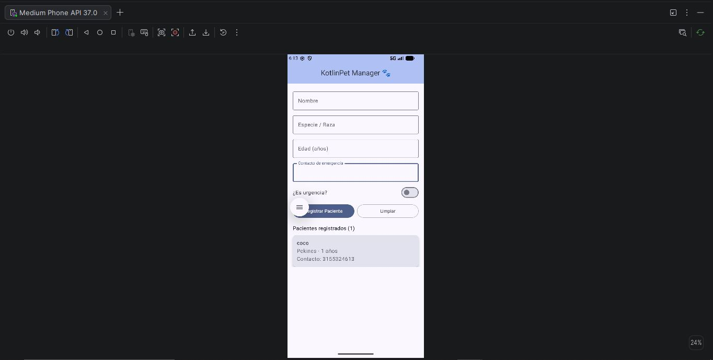

                  # KotlinPet Manager 🐾

**Estudiante:** Joan Sebastian Gonzalez Chaves
**Código:** TU CÓDIGO
**Asignatura:** Desarrollo de Aplicativos Móviles (EE053)

## Descripción
KotlinPet Manager es una aplicación Android para registrar y visualizar los
pacientes de una clínica veterinaria. Permite ingresar nombre, especie/raza,
edad, contacto de emergencia y si el paciente es una urgencia. Los pacientes
registrados se muestran en tiempo real en una lista.

## Tecnologías
- Kotlin
- Jetpack Compose y Material 3
- Arquitectura MVVM

## Estructura
- `model/`: data class `Paciente`
- `viewmodel/`: `PacienteViewModel` (estado y validaciones)
- `view/`: `PacienteScreen` (interfaz en Compose)

## Captura de pantalla
